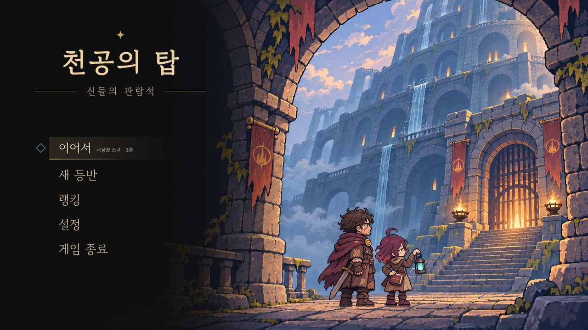
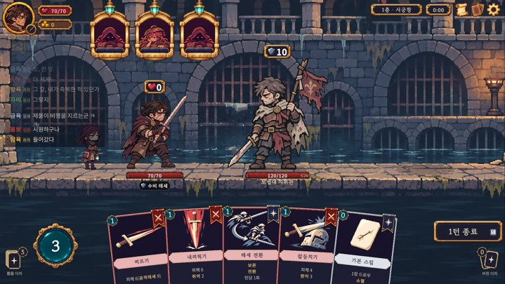
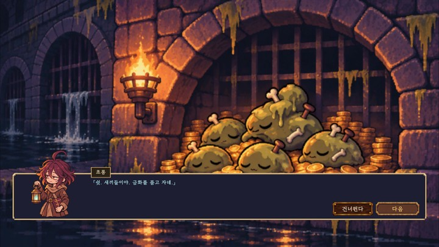
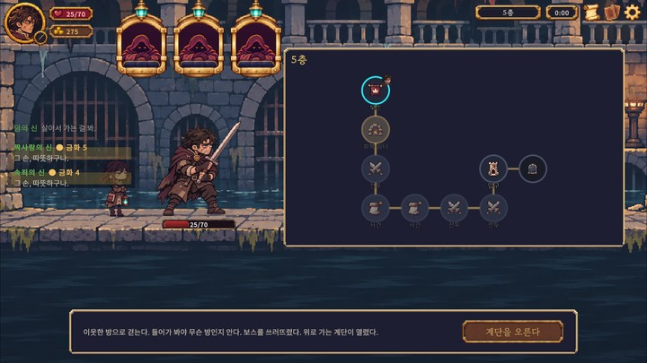
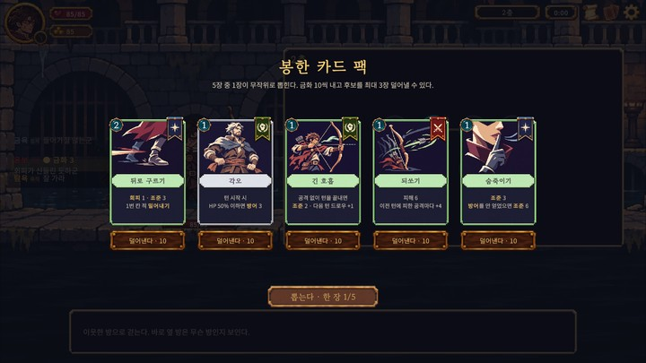
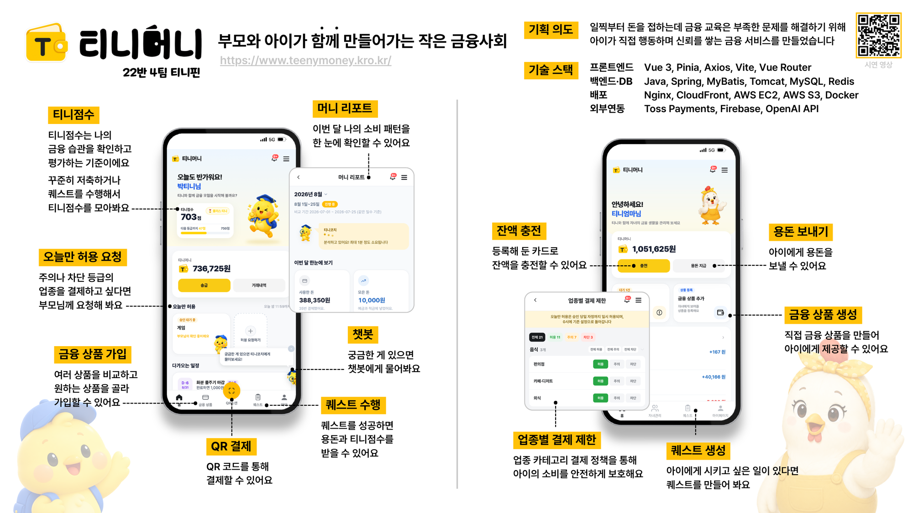

# 안녕하세요, 백엔드 개발자를 준비하는 we5046입니다 👋

Java·Spring으로 웹 백엔드를 만들고, C++ IOCP로 게임 서버를 공부합니다.
동작하는 데서 멈추지 않고, 사용자가 늘었을 때 어디가 먼저 문제가 되는지 재현하고 고치는 데 관심이 있습니다.

## 지금 하는 것

- 개인 프로젝트로 덱빌딩 로그라이크 게임 **천공의 탑: 신들의 관람석**을 Unity로 만들고 있습니다.
- 팀 프로젝트 **TeenyMoney**를 AWS에서 Oracle Cloud(OCI)로 이전해 운영하고 있습니다.
- Spring Legacy + MyBatis로 만든 게시판을 **Spring Boot 3 + JPA**로 다시 만들고 있습니다.

## 기술

**웹 백엔드**

**인프라**

**게임 서버 · 클라이언트**

## 진행 중인 개인 프로젝트

### 천공의 탑: 신들의 관람석 — 신들이 등반을 생중계로 지켜보는 덱빌딩 로그라이크

2026.11 ~ 개발 중 · 1인 개발 · Unity 6, C# · 웹 버전 프로토타입: (https://sky-tower-smoky.vercel.app/) 

탑을 오르는 플레이어를 신들이 인터넷 방송처럼 지켜봅니다. 신들은 플레이어의 전투와 선택에 채팅으로 반응하고 금화를 후원하며, 많이 후원한 신이 관람석 앞줄에 앉습니다.

| 전투와 신들의 관람석 | 선택이 따르는 사건 |
| :---: | :---: |
|  |  |
| **방을 골라 오르는 층 지도** | **덱을 키우는 카드 팩** |
|  |  |

- **게임**: 무기 7종과 카드 270여 장으로 덱을 만드는 턴제 전투, 층 지도·사건·상점·보상
- **구조**: 전투·런 규칙을 UnityEngine에 의존하지 않는 C# 엔진으로 분리하고, 화면은 엔진이 낸 이벤트만 받아 표시
- **재현성**: 난수를 쓰임마다 나눠 같은 시드면 같은 탑을 생성
- **검증**: 웹 프로토타입의 규칙을 C#으로 옮기면서, 같은 시드와 행동으로 두 엔진을 돌려 상태와 난수 호출 수를 자동 비교
- **데이터**: 카드·적·문구를 Google Sheets에서 관리하고 Unity로 가져올 때 형식 오류를 검사
- **AI 활용**: 코드와 그림 제작, 테스트에 AI를 본격적으로 활용

개발 중인 화면이라 실제와 달라질 수 있습니다.

## 대표 프로젝트

### TeenyMoney — 부모와 자녀가 함께 만드는 작은 금융사회 전자지갑

KB IT's Your Life 7기 팀 프로젝트 · 팀장 · [서비스 바로가기](https://www.teenymoney2.kro.kr)

- **공통 기반**: Spring MVC 프로젝트 구조, 공통 API 응답과 예외 처리, MyBatis·MySQL 연동
- **인증**: Spring Security + JWT, Redis에 Refresh Token을 저장해 토큰 재발급과 로그아웃 구현
- **회원·가족 연동**: 회원가입·로그인, 법정대리인 동의, S3 프로필 이미지 업로드, 부모와 자녀 연동
- **퀘스트**: 부모가 퀘스트를 만들고, 자녀가 수행에 성공하면 용돈과 티니점수를 받는 기능
- **머니리포트**: 이번 달 소비 패턴을 한눈에 보여 주는 기능
- **인프라**: AWS EC2에 Nginx와 Tomcat 연결, MySQL·Redis는 Docker 컨테이너로 운영, HTTPS 적용
- **협업 환경**: GitHub Issue·PR 템플릿, GitHub Actions 기반 CI
- **이전**: AWS 이용 기간이 끝난 뒤 서비스를 Oracle Cloud(OCI)로 이전

### 그 밖의 프로젝트

| 프로젝트 | 설명 | 기술 |
| --- | --- | --- |
| [IOCP-GameChatServer](https://github.com/we5046/IOCP-GameChatServer) | 비동기 멀티플레이 채팅 서버. 네트워크 I/O는 워커 스레드에서 병렬로, 게임 로직은 단일 스레드에서 직렬로 처리해 Player·Room에 락이 필요 없는 구조. 실시간 2인 대전 서버로 확장 중 | C++17, Winsock2, IOCP |
| [BombArenaClient](https://github.com/we5046/BombArenaClient) | 위 서버와 짝을 이루는 2D 폭탄 대전 클라이언트. 판정은 서버가 하고 클라이언트는 입력 전송과 화면 표시만 담당 | Unity 6, C# |
| [Fullstack_Proejct_A](https://github.com/we5046/Fullstack_Proejct_A) | 게시판·인증·갤러리를 REST API와 화면으로 나누어 구현한 풀스택 학습 프로젝트 | Spring MVC, Spring Security, MyBatis, Vue 3 |
